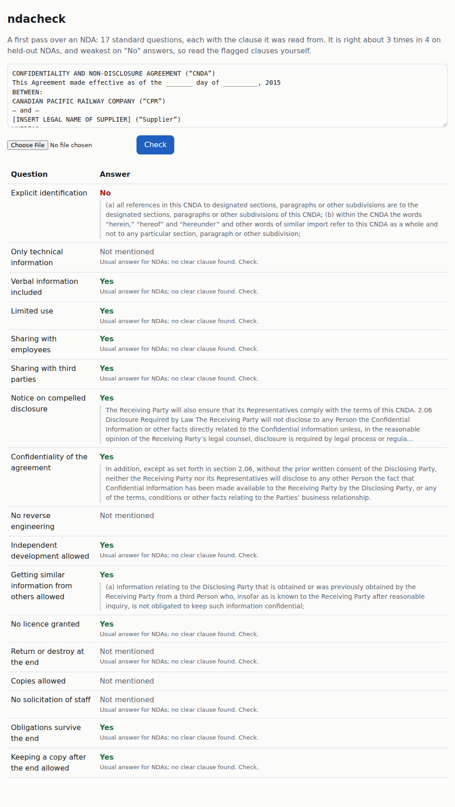

# ndacheck

First-pass NDA review: answers 17 standard questions about a non-disclosure agreement (non-solicit? must information be marked? can you keep a copy?)
and quotes the clause behind each answer, so a person reads only the flagged points.
Off-the-shelf NLI model plus thresholds fitted on ContractNLI; runs on a CPU; 73.8% accuracy on 123 held-out NDAs against 65.9% for always giving the usual answer.



## Results

ContractNLI test split (123 NDAs, 2091 question answers), and dev (61 NDAs, 1037 answers). The baseline answers each question with its most common
train-split answer. F1 per label: yes = Entailment, no = Contradiction.

| split | system | accuracy | macro-F1 | F1 yes | F1 no | F1 not mentioned |
|---|---|---|---|---|---|---|
| **test** | **ndacheck** | **73.8%** | **0.684** | 0.782 | 0.542 | 0.728 |
| test | ndacheck, own clause splitter (as the CLI and page run) | 74.1% | 0.685 | 0.787 | 0.538 | 0.729 |
| test | usual-answer baseline | 65.9% | 0.617 | 0.730 | 0.506 | 0.614 |
| dev | ndacheck | 74.2% | 0.688 | 0.790 | 0.564 | 0.710 |
| dev | usual-answer baseline | 68.1% | 0.633 | 0.753 | 0.516 | 0.629 |
| dev | tried: opposite statement as second hypothesis | 74.0% | 0.682 | 0.789 | 0.549 | 0.709 |
| dev | tried: + wider candidate keywords | 72.5% | 0.664 | 0.789 | 0.513 | 0.690 |
| dev | tried: + "yes" wins when a permission clause is found | 74.0% | 0.682 | 0.788 | 0.549 | 0.710 |

- **Old vs new.** The latest round of work tried three fixes for the weak "no" answers (below). None improved dev, so the system is unchanged and
  the test numbers are the same as before (73.8%, macro-F1 0.684, F1 no 0.542).
- **Per question** (`docs/results-test.md`): ahead of the baseline on 15 of 17 questions, tied on "sharing with third parties", behind on
  "limited use" (80% vs 84%). Biggest gains: "keeping a copy after the end" (57% vs 24%), "verbal information" (80% vs 59%),
  "independent development" (74% vs 59%).
- **Evidence.** When a yes/no answer is right, its quoted clause is one the annotators marked 74.4% of the time (897 answers, test).
- **How the test split was used.** Thresholds were fitted on train only and checked on dev; the three fixes were judged on train and dev only.
  The test split has been scored three times, never followed by any tuning: once with ContractNLI's clause boundaries (73.8%), once with
  ndacheck's own clause splitter and the same thresholds (74.1%), and once at the end of the latest round to confirm the unchanged system
  (73.8% again; it read the cached model scores).

### Why "no" answers are weak

Error analysis on dev (`docs/contradiction-experiments.md`): of 95 gold "no" answers, 44 are right and 51 missed. 20 misses are retrieval
(the keywords did not reach the annotated clause) and 31 are labelling. The off-the-shelf NLI model does not read "shall not disclose to
any third party" as contradicting "may share some information with some third parties", and nearly every NDA has such a prohibition:
whether the gold answer is "no" depends on whether a permission exists anywhere else in the document. Three fixes, each fitted on train,
raised train accuracy (up to 76.6%) but not dev, so they were dropped; the code is on the local branch `experiment/contradiction-fixes`
(tags `exp-fix1-fix3`, `exp-fix2`). The fix ideas came from reading dev errors, so dev is not a fully clean check for them; none was kept.
An earlier experiment with keyword rules that force "no" was dropped for the same reason (dev 74.2% -> 73.8%; kept in `git stash`).
The likely real fix is a model fine-tuned on ContractNLI, which this CPU-only project did not do.

## Quick start

```bash
git clone <this repo> && cd ndacheck
uv venv && uv pip install -r requirements.txt     # or: python -m venv .venv && .venv/bin/pip install -r requirements.txt
source .venv/bin/activate

python -m ndacheck examples/sample_nda.txt   # CLI on any .txt NDA; add --json for machine-readable output
uvicorn ndacheck.app:app --port 8850   # web page at http://localhost:8850: paste text or upload .pdf (with a text layer), .docx, .txt
pytest -q -m "not slow"                # fast tests (what CI runs); plain `pytest -q` also runs the model end to end
```

The first run downloads the NLI model (`cross-encoder/nli-deberta-v3-base`, about 0.7 GB) from Hugging Face.

CLI output on `examples/sample_nda.txt` (a three-clause test NDA; excerpt):

```
Verbal information included                      yes
    "1. Confidential Information includes all information disclosed in writing or orally."
Limited use                                      yes
    "2. The Recipient shall use Confidential Information solely for the Purpose."
Sharing with employees                           yes  (usual answer for NDAs; no clear clause, check)
...
No solicitation of staff                         yes
    "3. For one year the Recipient shall not solicit or hire any employee of the Discloser."
```

## How it works

1. Split the NDA into clauses.
2. For each question, keywords pick up to 4 candidate clauses. No match means "not mentioned".
3. An NLI model (`cross-encoder/nli-deberta-v3-base`) scores each candidate: does the clause entail or contradict the question's statement
   (e.g. "Receiving Party shall not solicit some of Disclosing Party's representatives.")?
4. Per-question thresholds, fitted on the ContractNLI train split (`ndacheck/thresholds.json`), turn the scores into yes / no / not
   mentioned. When no clause clears a threshold, the answer is the question's most common train-split answer, marked "no clear clause,
   check", with no quote.

Reproduce the numbers (needs the dataset, see Data):

```bash
python scripts/evaluate.py --split train --tune   # fit thresholds on train
python scripts/evaluate.py --split dev            # writes docs/results-dev.md
python scripts/evaluate.py --split test           # writes docs/results-test.md; add --own-clauses for the app's splitter
```

## Limits

- Not legal advice. About one answer in four is wrong, and "no" answers (the ones a business cares most about) are the weakest:
  F1 0.542 on test. Read every flagged clause.
- Only the 17 ContractNLI questions. Anything else in the NDA (governing law, term length, penalties) is ignored.
- English only. PDFs need a text layer; scans (OCR) are not supported.
- Keyword retrieval: a clause worded unusually is not seen at all.
- Not comparable to the ContractNLI paper's models, which were trained on this data; this is an off-the-shelf NLI model plus fitted
  thresholds, and likely below them.

## Data and licences

- Code: MIT (`LICENSE`).
- [ContractNLI](https://stanfordnlp.github.io/contract-nli/) (Koreeda and Manning, 2021, "ContractNLI: A Dataset for Document-level
  Natural Language Inference for Contracts"): CC BY 4.0. 607 NDAs (423 train, 61 dev, 123 test), each annotated for 17 hypotheses as
  Entailment, Contradiction or NotMentioned, with evidence spans. The dataset is not redistributed here; download it yourself:

  ```bash
  mkdir -p data/raw && cd data/raw
  curl -L -o contract-nli.zip https://stanfordnlp.github.io/contract-nli/resources/contract-nli.zip && unzip contract-nli.zip
  ```

  This repo contains only material derived from it: the 17 hypothesis statements (in `ndacheck/check.py`), thresholds fitted on train,
  result tables, and the screenshot, which shows part of one public NDA from the dataset.
- NLI model: `cross-encoder/nli-deberta-v3-base`, Apache-2.0 per its model card; downloaded at run time, not bundled.
